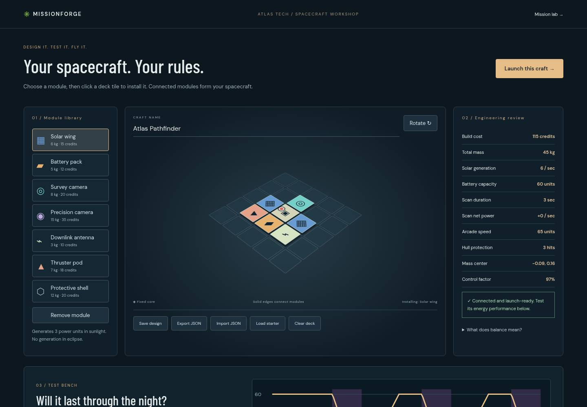
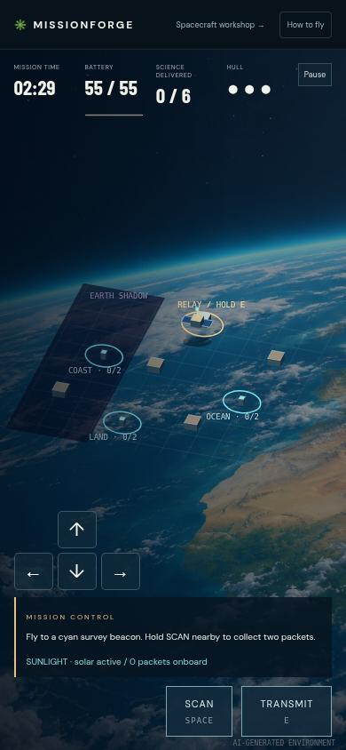

# QA audit — 14 November 2026

## Result and environment

- **30 Node model tests passed.**
- **29 Playwright browser cases passed**, with one intentionally skipped desktop copy of the mobile-only touch test. The full suite contains 15 scenarios across desktop and phone projects. The failure/refit scenario was subsequently shortened from a full timeout wait to battery depletion; mission timeout also has a model regression test.
- Actual headless **Chromium 156** rendered and interacted with the site, at desktop **1440×1000** and mobile-emulated **390×844**. This replaces the earlier DOM-only checks; the attached interactive browser service was not required.
- Additional layout checks at **320×568**, **768×1024**, and **1366×768** found no horizontal overflow on the game, workshop, lab or deck pages.
- PDF export verified as **seven landscape A4 pages**, with the team names and final slide present. PDF links point to the public project, not localhost.

This is feature and workflow coverage, not enumeration of every possible spacecraft arrangement. Physical Android/iOS devices and Safari/Firefox were not tested. External NASA documents and remote production hosting were not part of the local browser test suite.

## Coverage

| Area | Checks performed |
|---|---|
| Workshop modules | All seven selectable module types; all 24 editable deck cells; fixed core protection; replacement/removal; all four view rotations; clear and starter controls |
| Launch rules | Connected/disconnected layouts; required systems; duplicate-camera invalidity through replacement tests and model rules; valid starter launch |
| Fleet | Save, rename, replacement by name, eight-design limit, reload persistence, load, compare/stop comparing and delete |
| Files | Real download, Import button/file chooser, round-trip JSON, malformed JSON, changed core, oversized input, non-string IDs and arrays |
| Power bench | Both slider controls at 0%, 50% and 100%; comparison curve; 33% fractional eclipse regression; initial empty battery; storage versus generation |
| Fail-safe storage | Blocked local/session storage; malformed stored data; invalid custom flight transfer |
| Flight presets | All eight equipment combinations; over-budget launch disabled |
| Flight controls | Real keyboard route to collect and transmit six packets; all four movement touch buttons; touch scan/transmit press/release; pause/resume/help |
| Mission outcomes | Continuous wins with default and custom hardware; collision invulnerability; energy depletion; timeout; retry; custom refit restores exact design |
| Engineering lab | All 13 equipment options; three objective examples; six passed checks; reset; result invalidation; iterate focus; history clearing; 288 model configurations |
| Academy | All answer choices across repeated sessions; correct and incorrect feedback; closed/reopened state; three objective badges; duplicate badge prevention |
| Navigation and deck | Local links respond; explanatory disclosure expands; slide keyboard navigation; seven-slide structure and seven-page PDF |
| Rendering | Actual desktop/mobile screenshots inspected; no page JavaScript errors in passing browser cases; generated art and local assets load |

## Bugs corrected

1. **Empty deck tiles did not reliably accept clicks.** Chromium hit the transformed deck parent instead of the empty button. The projected parent now ignores pointer events, while each tile explicitly accepts them and sits above the parent plane. Real click tests now cover every tile.
2. **Fractional eclipse percentages drifted from displayed average power.** A partial sunlight second was previously rounded into a full sunlight second. The bench now integrates the fraction of sunlight in that second, matching the displayed average.
3. **Empty batteries were reported as depleting one second late.** Initial zero capacity now reports depletion at time zero.
4. **Malformed design JSON accepted array-shaped cells or coercible non-string module IDs.** These shapes are now rejected, and empty names normalize to a safe default.
5. **Keyboard downlink did not draw the same transmission beam as touch downlink.** Drawing now uses the unified action input.
6. **Small-screen labels collided and generated-art attribution was drawn twice.** Mobile survey labels are shorter, redundant debris labels are removed on small screens, and attribution appears once.
7. **Some decorative glyphs rendered as missing characters.** Navigation uses supported arrows; pause/remove labels remain readable without special glyphs.
8. **PDF export would preserve localhost links.** A repeatable export command now sets the public base URL before printing.

## Reproduce

```sh
npm ci
npm test
npm run test:browser
```

The browser configuration uses system Chromium when available, otherwise Playwright's installed Chromium. Run `npx playwright install chromium` if necessary, or set `CHROMIUM_PATH`. The suite starts a local Python server on port 8765. Do not run multiple Playwright commands concurrently with the same output directory.

To regenerate the PDF, start the local server (`npm start`) and run `npm run export:deck` in another terminal.

## Visual evidence

[Desktop workshop](qa/shipyard-desktop.jpg) · [Mobile flight](qa/flight-mobile.jpg) · [Seven-page presentation](presentation.pdf)




